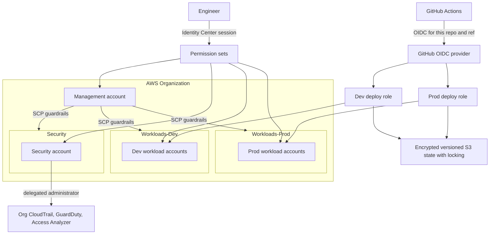

# aws-iam-foundation

Secure AWS identity foundation, built with Terraform and operated from this repository.

The design uses AWS Organizations, IAM Identity Center for people, and GitHub Actions OpenID Connect (OIDC) for automation. There are no IAM users and no long-lived access keys. Preventive guardrails are service control policies (SCPs). Detective controls (an organization CloudTrail, GuardDuty, and IAM Access Analyzer) are delegated to a Security account. Terraform state lives in an encrypted, versioned S3 backend with locking.

This repository is the scaffold only. It contains no Terraform modules and deploys nothing. The [roadmap](#roadmap) is the order of work. Complete the [root-account lockdown](docs/root-account-lockdown.md) before any later milestone applies infrastructure.

## Target architecture

This diagram is the design the later milestones implement.



People sign in through IAM Identity Center and receive temporary credentials. GitHub Actions assumes a deploy role through OIDC. The trust policy will allow this repository only, and only the ref that should deploy. The production role is approval-gated by a GitHub `production` environment. SCPs apply to every OU, including Security. The Security account is the delegated administrator for the organization trail, GuardDuty, and Access Analyzer. Workloads do not run in the management account.

## Architecture decisions

These decisions are accepted for the design. The milestones below implement them. Each record stays short until the module that carries it exists.

### ADR-001: People use Identity Center

Human access is IAM Identity Center permission sets. The foundation does not create IAM users, IAM user passwords, or IAM user access keys. Root credentials stay offline and are used only for the tasks that require root. See [docs/root-account-lockdown.md](docs/root-account-lockdown.md).

### ADR-002: Automation uses GitHub OIDC

Deploy roles trust GitHub's OIDC issuer. The `sub` claim is limited to this repository and to the branch or GitHub Environment that is allowed to deploy. Workflows receive no static AWS credentials. Production applies run from the `production` environment and require a reviewer.

### ADR-003: Three top-level OUs

The organization has a Security OU, a Workloads-Dev OU, and a Workloads-Prod OU. The management account holds the organization, the SCPs, and IAM Identity Center. Application workloads go in the workload OUs. Security tooling is delegated to the Security account so a compromise of a workload account does not own the trail or the detectors.

### ADR-004: SCPs are guardrails

SCPs deny classes of action that the foundation must prevent (for example disabling the trail, leaving the organization, or weakening the account baseline). Access is granted only by identity-based policies and permission sets, which stay least privilege. Exceptions are explicit, reviewed, and covered by tests.

### ADR-005: Remote state is encrypted, versioned, and locked

State is not committed. The backend bucket is encrypted, versioned, and blocks public access. Locking prevents concurrent applies. `.terraform.lock.hcl` is committed so provider versions and hashes are reproducible. The lock mechanism (S3 lockfile or a separate lock table) is chosen when the bootstrap milestone pins the Terraform version. Variable files (`*.tfvars`) stay local; only `*.tfvars.example` templates are committed.

### ADR-006: Detective controls live in the Security account

Organization CloudTrail, GuardDuty, and IAM Access Analyzer use a delegated administrator in the Security account. A billing alarm watches estimated charges so a mistake during bootstrap is visible before the organization trail exists. The alarm is created by hand during root lockdown and codified in milestone 10.

## Security model

Milestone 11 completes this STRIDE-lite assessment: abuse cases, existing controls, and residual risk. The notes below are the frame. They do not mean the controls exist yet, and they do not record accepted risk.

### Assets

- Organization, OU layout, and SCPs
- IAM Identity Center permission sets and assignments
- GitHub OIDC provider, trust policy, and deploy roles
- Terraform state bucket, lock, and plan output
- CloudTrail, GuardDuty, and Access Analyzer configuration
- Root credentials and recovery channels, which stay outside this repository

### Trust boundaries

- Engineer browser or CLI to IAM Identity Center
- GitHub Actions runner to the AWS deploy role, crossed only with an OIDC token
- Management account to member accounts, constrained by SCPs
- Security account to organization-wide logs and findings
- Operator workstation to the state backend

### Actors to consider

- The repository owner, operating with a permission set
- GitHub Actions for this repository and the allowed ref
- A pull request or dependency that changes a workflow, a policy, or a provider
- A stolen session or a stolen OIDC token
- Anyone who obtains root credentials or a recovery channel

### STRIDE-lite

| Category | What milestone 11 will examine | Status |
| --- | --- | --- |
| Spoofing | OIDC `sub` too wide; Identity Center federation; confused deputy on the deploy role | Open |
| Tampering | State object, SCP documents, workflow files, lock file | Open |
| Repudiation | Root sign-in, deploy-role sessions, production approvals, CloudTrail integrity | Open |
| Information disclosure | State bucket, CI logs, plan output, tfvars, Access Analyzer findings | Open |
| Denial of service | SCP that blocks remediation, disabled trail or GuardDuty, state lock stuck, surprise spend | Open |
| Elevation of privilege | Wildcard permission sets, root access keys, ability to edit trust policies or workflows without review | Open |

### Out of scope for this model

Workload application security, guest operating-system hardening, and vulnerabilities in AWS services themselves. Report AWS platform issues to [AWS Security](https://aws.amazon.com/security/vulnerability-reporting/). Report issues in this repository through [SECURITY.md](SECURITY.md).

## Repository layout

Present in this scaffold:

```text
.
├── .editorconfig
├── .github
│   ├── CODEOWNERS
│   ├── ISSUE_TEMPLATE
│   │   ├── bug.yml
│   │   ├── config.yml
│   │   └── feature.yml
│   ├── dependabot.yml
│   └── pull_request_template.md
├── .gitignore
├── docs
│   └── root-account-lockdown.md
├── LICENSE
├── README.md
└── SECURITY.md
```

Planned, and created by the milestone that fills them:

```text
bootstrap/                  # one-time remote state backend
modules/
  organizations/            # organization and OUs
  scp/                      # guardrail policies and tests
  identity-center/          # permission sets
  github-oidc/              # OIDC provider and deploy roles
  security-baseline/        # CloudTrail, GuardDuty, Access Analyzer, billing alarm
envs/
  management/               # org, SCPs, Identity Center, OIDC
  security/                 # delegated security services
docs/                       # this lockdown checklist, then ADRs and the threat model
.github/workflows/          # pull-request plan and security scans
```

`.terraform.lock.hcl` files are committed next to the configuration that selects providers. State, `.terraform/` directories, plans, and `*.tfvars` are ignored. See [.gitignore](.gitignore).

## Prerequisites

- An AWS account you control, which will become the Organizations management account.
- Root lockdown complete or in progress, using [docs/root-account-lockdown.md](docs/root-account-lockdown.md).
- Two phishing-resistant MFA devices for root (FIDO2 security keys or passkeys), stored apart from each other.
- A password manager for the root password.
- Terraform 1.10 or later, AWS CLI v2, and Git.
- Admin access to this GitHub repository, so later milestones can add the OIDC trust, the `production` environment, and branch protection.
- No IAM user and no access keys. Do not create either one to unblock Terraform.

Identity Center arrives in a later milestone. The state-backend bootstrap uses a short-lived management-account session.

## Deployment

There is nothing to plan or apply in this commit.

Intended order, once the modules exist:

1. Finish root lockdown.
2. Apply the state backend once, from a trusted workstation, with a short-lived session. Migrate any local state into that backend before further applies.
3. Open pull requests for each milestone. Review the plan in the pull request. Do not paste secrets, account IDs, or state into the discussion.
4. Apply non-production changes from the dev deploy role after the OIDC role exists.
5. Apply production from the GitHub `production` environment after a required reviewer approves the run.

Until those workflows exist, applies are manual and local, and only for the milestone that introduced the configuration. Production approval is a required reviewer on the GitHub `production` environment.

## Break-glass procedure

This procedure is a placeholder. It is not operational, and there is no break-glass role yet.

Milestone 11 replaces this section with the real procedure. That write-up will define:

- The conditions that justify break-glass (Identity Center unavailable, deploy role unusable, SCP blocking remediation), and the conditions that do not.
- Who holds the password and who holds MFA, when more than one operator exists.
- The maximum session length and the ticket or notification required before use.
- How the session is identified in CloudTrail afterward.
- How credentials are rotated and how the incident is closed.

Until Identity Center exists, the only emergency credential is the management-account root user. Use it only for tasks that require root, then sign out. The lockdown checklist is the control on that credential. Day-to-day administration and Terraform applies wait for Identity Center and the deploy roles.

## Roadmap

- [ ] 1. Root lockdown and repository scaffold
  - [x] Repository scaffold and hygiene
  - [ ] Management-account root lockdown ([checklist](docs/root-account-lockdown.md))
- [ ] 2. S3 state backend bootstrap
- [ ] 3. Pre-commit hooks (terraform fmt, tflint, gitleaks, checkov)
- [ ] 4. Organizations and OUs module
- [ ] 5. SCP guardrails module with tests
- [ ] 6. IAM Identity Center permission sets
- [ ] 7. GitHub OIDC provider and scoped dev deploy role
- [ ] 8. Pull-request CI workflow running plan and security scans
- [ ] 9. Prod role and approval-gated `production` environment
- [ ] 10. Organization CloudTrail, GuardDuty, Access Analyzer, and billing alarm
- [ ] 11. Finished README and threat model

## Working in this repo

Use the issue forms for bugs and for features or tasks. Pull requests follow [.github/pull_request_template.md](.github/pull_request_template.md). Commit messages follow [Conventional Commits](https://www.conventionalcommits.org/). Report vulnerabilities through [SECURITY.md](SECURITY.md), not through a public issue.

[MIT License](LICENSE). Copyright Tyler Pearson 2026.
