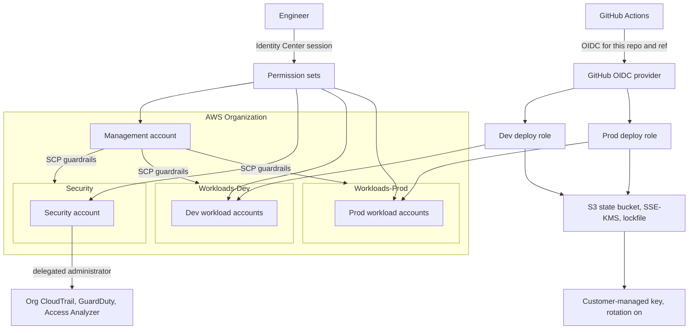

# aws-iam-foundation

Secure AWS identity foundation, built with Terraform and operated from this repository.

The design uses AWS Organizations, IAM Identity Center for people, and GitHub Actions OpenID Connect (OIDC) for automation. There are no IAM users and no long-lived access keys. Preventive guardrails are service control policies (SCPs). Detective controls (an organization CloudTrail, GuardDuty, and IAM Access Analyzer) are delegated to a Security account. Terraform state lives in an encrypted, versioned S3 backend with locking.

Milestone 2 is the state-backend bootstrap in [`bootstrap/state-backend`](bootstrap/state-backend). It deploys only when you apply it. The organization, Identity Center, and guardrails are still ahead. The [roadmap](#roadmap) is the order of work. Complete the [root-account lockdown](docs/root-account-lockdown.md) before that apply.

## Target architecture

This diagram is the design the later milestones implement.



People sign in through IAM Identity Center and receive temporary credentials. GitHub Actions assumes a deploy role through OIDC. The trust policy will allow this repository only, and only the ref that should deploy. The production role is approval-gated by a GitHub `production` environment. SCPs apply to every OU, including Security. The Security account is the delegated administrator for the organization trail, GuardDuty, and Access Analyzer. Workloads do not run in the management account.

The state bucket is versioned, encrypted with a customer-managed key, and locked with Terraform's S3 lockfile (`use_lockfile`). Server access logs go to a second bucket. Deploy roles do not exist yet; the bootstrap apply is a local admin session, described under [Deployment](#deployment).

## Architecture decisions

These decisions are accepted for the design. Milestone 2 implements ADR-005. The others are still ahead.

### ADR-001: People use Identity Center

Human access is IAM Identity Center permission sets. The foundation does not create IAM users, IAM user passwords, or IAM user access keys. Root credentials stay offline and are used only for the tasks that require root. See [docs/root-account-lockdown.md](docs/root-account-lockdown.md).

### ADR-002: Automation uses GitHub OIDC

Deploy roles trust GitHub's OIDC issuer. The `sub` claim is limited to this repository and to the branch or GitHub Environment that is allowed to deploy. Workflows receive no static AWS credentials. Production applies run from the `production` environment and require a reviewer.

### ADR-003: Three top-level OUs

The organization has a Security OU, a Workloads-Dev OU, and a Workloads-Prod OU. The management account holds the organization, the SCPs, and IAM Identity Center. Application workloads go in the workload OUs. Security tooling is delegated to the Security account so a compromise of a workload account does not own the trail or the detectors.

### ADR-004: SCPs are guardrails

SCPs deny classes of action that the foundation must prevent (for example disabling the trail, leaving the organization, or weakening the account baseline). Access is granted only by identity-based policies and permission sets, which stay least privilege. Exceptions are explicit, reviewed, and covered by tests.

### ADR-005: Remote state is encrypted, versioned, and locked with an S3 lockfile

State is not committed. The backend bucket is encrypted with a customer-managed KMS key (rotation on), versioned, and blocks public access. Uploads that are not TLS, or that do not name that key, are denied. `.terraform.lock.hcl` is committed so provider versions and hashes are reproducible. Variable files (`*.tfvars`) stay local; only `*.tfvars.example` templates are committed.

Locking uses Terraform's native S3 lockfile (`use_lockfile = true`), which needs Terraform 1.10 or later. Terraform writes a `.tflock` object beside the state object and relies on S3 conditional writes. DynamoDB locking is deprecated in Terraform and this foundation does not create a lock table: one less datastore, and the lock is covered by the same bucket policy as the state. Noncurrent versions, including lock-object versions, expire after 90 days, with the five newest retained.

The bootstrap root module is applied once with local state, then its own state can be migrated into the bucket. See [bootstrap/state-backend](bootstrap/state-backend). Server access logs for the state bucket go to a second bucket encrypted with SSE-S3, because S3 log delivery does not support an SSE-KMS destination. Organization CloudTrail data events for both buckets remain milestone 10.

### ADR-006: Detective controls live in the Security account

Organization CloudTrail, GuardDuty, and IAM Access Analyzer use a delegated administrator in the Security account. A billing alarm watches estimated charges so a mistake during bootstrap is visible before the organization trail exists. The alarm is created by hand during root lockdown and codified in milestone 10.

## Security model

Milestone 11 completes this STRIDE-lite assessment: abuse cases, existing controls, and residual risk. The notes below are the frame. They do not mean the controls exist yet, and they do not record accepted risk.

### Assets

- Organization, OU layout, and SCPs
- IAM Identity Center permission sets and assignments
- GitHub OIDC provider, trust policy, and deploy roles
- Terraform state bucket, lock, and plan output
- CloudTrail, GuardDuty, and Access Analyzer configuration
- Root credentials and recovery channels, which stay outside this repository

### Trust boundaries

- Engineer browser or CLI to IAM Identity Center
- GitHub Actions runner to the AWS deploy role, crossed only with an OIDC token
- Management account to member accounts, constrained by SCPs
- Security account to organization-wide logs and findings
- Operator workstation to the state backend

### Actors to consider

- The repository owner, operating with a permission set
- GitHub Actions for this repository and the allowed ref
- A pull request or dependency that changes a workflow, a policy, or a provider
- A stolen session or a stolen OIDC token
- Anyone who obtains root credentials or a recovery channel

### STRIDE-lite

| Category | What milestone 11 will examine | Status |
| --- | --- | --- |
| Spoofing | OIDC `sub` too wide; Identity Center federation; confused deputy on the deploy role | Open |
| Tampering | State object, SCP documents, workflow files, lock file | Open |
| Repudiation | Root sign-in, deploy-role sessions, production approvals, CloudTrail integrity | Open |
| Information disclosure | State bucket, CI logs, plan output, tfvars, Access Analyzer findings | Open |
| Denial of service | SCP that blocks remediation, disabled trail or GuardDuty, state lock stuck, surprise spend | Open |
| Elevation of privilege | Wildcard permission sets, root access keys, ability to edit trust policies or workflows without review | Open |

### Out of scope for this model

Workload application security, guest operating-system hardening, and vulnerabilities in AWS services themselves. Report AWS platform issues to [AWS Security](https://aws.amazon.com/security/vulnerability-reporting/). Report issues in this repository through [SECURITY.md](SECURITY.md).

## Repository layout

Present:

```text
.
├── .editorconfig
├── .github
│   ├── CODEOWNERS
│   ├── ISSUE_TEMPLATE
│   │   ├── bug.yml
│   │   ├── config.yml
│   │   └── feature.yml
│   ├── dependabot.yml
│   └── pull_request_template.md
├── .gitignore
├── bootstrap
│   └── state-backend       # remote state bucket, KMS key, access logs
├── docs
│   └── root-account-lockdown.md
├── LICENSE
├── README.md
└── SECURITY.md
```

Planned, and created by the milestone that fills them:

```text
modules/
  organizations/            # organization and OUs
  scp/                      # guardrail policies and tests
  identity-center/          # permission sets
  github-oidc/              # OIDC provider and deploy roles
  security-baseline/        # CloudTrail, GuardDuty, Access Analyzer, billing alarm
envs/
  management/               # org, SCPs, Identity Center, OIDC
  security/                 # delegated security services
docs/                       # this lockdown checklist, then ADRs and the threat model
.github/workflows/          # pull-request plan and security scans
```

`.terraform.lock.hcl` files are committed next to the configuration that selects providers. State, `.terraform/` directories, plans, and `*.tfvars` are ignored. See [.gitignore](.gitignore).

## Prerequisites

- An AWS account you control, which will become the Organizations management account.
- Root lockdown complete or in progress, using [docs/root-account-lockdown.md](docs/root-account-lockdown.md).
- Two phishing-resistant MFA devices for root (FIDO2 security keys or passkeys), stored apart from each other.
- A password manager for the root password.
- Terraform 1.10 or later (the S3 lockfile needs it), AWS CLI v2, and Git.
- An SSO session or assumed-role admin profile for the bootstrap apply. The root user is the wrong credential for that apply.
- Admin access to this GitHub repository, so later milestones can add the OIDC trust, the `production` environment, and branch protection.
- No IAM user and no access keys. Do not create either one to unblock Terraform.

Identity Center arrives in a later milestone. The state-backend bootstrap uses a short-lived management-account session.

## Deployment

### Bootstrap the state backend

This is the one root module that starts on local state. The bucket does not exist until the first apply. Use an SSO session or an assumed-role admin profile. Do not use the root user, and do not create access keys. The module README has the migration and recovery detail: [bootstrap/state-backend/README.md](bootstrap/state-backend/README.md).

```bash
export AWS_PROFILE=your-admin-profile
cd bootstrap/state-backend
cp terraform.tfvars.example terraform.tfvars
```

Edit `terraform.tfvars`. Choose a globally unique `name_prefix` and the `aws_region`.

```bash
terraform init -backend=false
terraform plan -out=tfplan
terraform apply tfplan
```

To move this module's own state into the bucket afterwards:

```bash
umask 077
terraform output -raw backend_config_hcl > backend.hcl
cat > backend.tf <<'EOF'
terraform {
  backend "s3" {}
}
EOF
terraform init -migrate-state -backend-config=backend.hcl
terraform state pull >/dev/null
rm -f terraform.tfstate terraform.tfstate.backup tfplan
```

`backend.hcl` contains the KMS key ARN, and that ARN contains the account ID. It is gitignored. Keep it in a password manager, not in a pull request. Later root modules copy [backend.hcl.example](bootstrap/state-backend/backend.hcl.example) and set their own `key`.

### After the backend exists

1. Open pull requests for each milestone. Review the plan in the pull request. Do not paste secrets, account IDs, or state into the discussion.
2. Apply non-production changes from the dev deploy role after the OIDC role exists.
3. Apply production from the GitHub `production` environment after a required reviewer approves the run.

Until those workflows exist, applies are manual and local, and only for the milestone that introduced the configuration. Production approval is a required reviewer on the GitHub `production` environment.

## Break-glass procedure

This procedure is a placeholder. It is not operational, and there is no break-glass role yet.

Milestone 11 replaces this section with the real procedure. That write-up will define:

- The conditions that justify break-glass (Identity Center unavailable, deploy role unusable, SCP blocking remediation), and the conditions that do not.
- Who holds the password and who holds MFA, when more than one operator exists.
- The maximum session length and the ticket or notification required before use.
- How the session is identified in CloudTrail afterward.
- How credentials are rotated and how the incident is closed.

Until Identity Center exists, the only emergency credential is the management-account root user. Use it only for tasks that require root, then sign out. The lockdown checklist is the control on that credential. Milestone 2 applies the state backend with a separate short-lived management-account session. Later applies move to the Identity Center permission sets and the OIDC deploy roles.

## Roadmap

- [ ] 1. Root lockdown and repository scaffold
  - [x] Repository scaffold and hygiene
  - [ ] Management-account root lockdown ([checklist](docs/root-account-lockdown.md))
- [x] 2. S3 state backend bootstrap
- [ ] 3. Pre-commit hooks (terraform fmt, tflint, gitleaks, checkov)
- [ ] 4. Organizations and OUs module
- [ ] 5. SCP guardrails module with tests
- [ ] 6. IAM Identity Center permission sets
- [ ] 7. GitHub OIDC provider and scoped dev deploy role
- [ ] 8. Pull-request CI workflow running plan and security scans
- [ ] 9. Prod role and approval-gated `production` environment
- [ ] 10. Organization CloudTrail, GuardDuty, Access Analyzer, and billing alarm
- [ ] 11. Finished README and threat model

## Working in this repo

Use the issue forms for bugs and for features or tasks. Pull requests follow [.github/pull_request_template.md](.github/pull_request_template.md). Commit messages follow [Conventional Commits](https://www.conventionalcommits.org/). Report vulnerabilities through [SECURITY.md](SECURITY.md), not through a public issue.

[MIT License](LICENSE). Copyright Tyler Pearson 2026.
