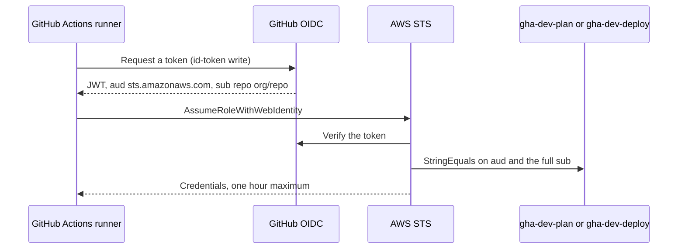

# GitHub OIDC

Root module for the GitHub Actions OIDC provider and the dev plan and deploy roles. Apply it in the **dev workload account** with an SSO session or an assumed-role admin profile. Do not use the root user. Do not create access keys.

State is stored in the bucket from [bootstrap/state-backend](../bootstrap/state-backend), at `github-oidc/terraform.tfstate`. A person applies this root. The roles it creates are for later dev stacks, under `state_key_prefix`, not for this state key.



The workflow sketch is [docs/github-oidc-workflow.md](../docs/github-oidc-workflow.md). It is not an active workflow. Milestone 8 adds `.github/workflows/`.

`example-org` and `example-repo` are placeholders. For a pipeline on this repository those values are `Rekkie19` and `aws-iam-foundation`. They belong in `terraform.tfvars`, which is gitignored. The workflow reads the role ARN from a repository variable and does not contain an account ID.

## Apply order

1. Apply [organization](../organization).
2. Attach [scps](../scps) at least to Workloads-Dev.
3. Apply [identity-center](../identity-center), including MFA in the console.
4. Apply this root in the dev account. The dev SCP still applies to these roles. `GhaDevBoundary` is created here because this provider is the dev account. It is a separate policy from `DevPowerUserBoundary`.

```bash
export AWS_PROFILE=your-dev-admin-profile
cd github-oidc
cp terraform.tfvars.example terraform.tfvars
cp backend.hcl.example backend.hcl
```

Edit `backend.hcl` from the state-backend outputs. Leave the key as `github-oidc/terraform.tfstate`. Edit `terraform.tfvars`. Replace the placeholder account id, the placeholder KMS key ARN, the bucket name, and the GitHub org and repo.

```bash
terraform init -backend=false
terraform test
terraform init -backend-config=backend.hcl
terraform plan -out=tfplan
terraform apply tfplan
terraform output -raw plan_role_arn
terraform output -raw deploy_role_arn
```

Store those ARNs in the GitHub repository variables `AWS_DEV_PLAN_ROLE_ARN` and `AWS_DEV_DEPLOY_ROLE_ARN`. Store the region in `AWS_REGION`. Do not store them as secrets, and do not paste a plan that contains real account ids into a pull request.

`terraform test` does not need AWS. `terraform.tfvars` and `backend.hcl` are gitignored.

## Thumbprints

The provider is `https://token.actions.githubusercontent.com` and the client id is `sts.amazonaws.com`.

AWS no longer validates thumbprints for this issuer. It trusts the issuer through its own CA library. A thumbprint left over from the old console flow is stored and ignored. In the current AWS provider, `thumbprint_list` is optional. Leave `thumbprint_list` unset. The provider may fetch a certificate thumbprint and save it in state. That value is not a control. Set the variable only when you want to pin a fetched thumbprint and stop a diff. A thumbprint change is not evidence that GitHub was replaced.

## Roles

| Role | Trust `sub` | Session | Identity policy |
| --- | --- | --- | --- |
| `gha-dev-plan` | `repo:ORG/REPO:pull_request` | 3600 seconds | `ReadOnlyAccess`, plus state read and lock-object writes under `state_key_prefix` |
| `gha-dev-deploy` | `repo:ORG/REPO:ref:refs/heads/main` and `repo:ORG/REPO:environment:dev` | 3600 seconds | `deploy_actions` on `deploy_resource_arns`, plus read/write of state under the same prefix |

The condition is `StringEquals` on `token.actions.githubusercontent.com:aud` and on the full `sub`. There is no `StringLike`. Validation rejects an empty org or repo and rejects `*` in the org, the repo, a ref, or an environment name.

`deploy_actions` is a starting allowlist (describe a few EC2 and log calls, and bucket metadata). It is not the permission set these pipelines should keep. Replace it with the actions the dev stack uses, and narrow `deploy_resource_arns` from `*`. `iam:PassRole` is not in that list. `pass_role_arns` adds `iam:PassRole` only for explicit role ARNs, with no wildcard. The default is an empty list.

`ReadOnlyAccess` on the plan role is broader than the state prefix. It is the AWS managed read policy, so this root does not keep a second copy of every read action. Writes on that role are only `s3:PutObject` and `s3:DeleteObject` on `PREFIX*.tflock`, plus the KMS calls those writes need. The plan role cannot put the state object itself.

Both roles wear `GhaDevBoundary`. The document is [boundary/gha-dev-boundary.json](boundary/gha-dev-boundary.json). `Allow *` is the ceiling. A deny-only boundary would leave the role with no effective permissions. The denies match the DevPowerUser boundary: IAM users and access keys, organization changes, disabling CloudTrail, GuardDuty, AWS Config, and IAM Access Analyzer, and any edit to this boundary or to a role that does not wear it. `iam:CreateServiceLinkedRole` is not denied. Service-linked roles cannot take this custom boundary.

## State bucket grants

These roles get identity policies for the state bucket and the state KMS key. The bucket and the key are in the state account. Their resource policies still have to allow the role. This root does not edit [bootstrap/state-backend](../bootstrap/state-backend). After apply, add a bucket statement and a key statement for each role ARN.

Bucket statement, scoped to the same prefix:

```json
{
  "Sid": "DevGitHubState",
  "Effect": "Allow",
  "Principal": { "AWS": "ROLE_ARN" },
  "Action": ["s3:GetObject", "s3:PutObject", "s3:DeleteObject"],
  "Resource": "arn:aws:s3:::BUCKET/envs/dev/*"
}
```

Use `s3:GetObject` only, plus `PutObject` and `DeleteObject` on `envs/dev/*.tflock`, for the plan role. The key policy needs `kms:Decrypt`, `kms:Encrypt`, `kms:GenerateDataKey`, and `kms:DescribeKey` for that principal. Keep `kms:ViaService` on the cryptographic actions.

Do not point `state_key_prefix` at `github-oidc/`. Validation rejects a prefix that covers this root's state key, so the deploy role cannot rewrite the trust policy that it holds.

## Threats

**Subject spoofing.** GitHub sets `sub`. The caller cannot pick it. A `StringLike` pattern such as `repo:example-org/*` would let every repository in the org assume the role. This root builds the subject from `github_org` and `github_repo` and compares it with `StringEquals`. A plan that puts `*` in either name fails validation.

**Fork pull requests.** `pull_request` from a fork does not receive this repository's secrets, and GitHub does not mint an OIDC token for that job. The same `pull_request` subject is used for a pull request opened from a branch in this repository. Anyone who can run a workflow on that event with `id-token: write` can assume `gha-dev-plan` and read the dev account through `ReadOnlyAccess`.

**`pull_request_target`.** That event runs in the base repository. It can mint an OIDC token. If the job checks out the pull request head, fork code runs with the plan role. Do not use `pull_request_target` for these roles. The sketch does not.

**Environment `dev`.** `gha-dev-deploy` trusts `environment:dev` as well as `refs/heads/main`. A workflow that names that environment can deploy from a branch other than main unless the GitHub environment allows only `main`. Set that deployment branch rule. Clear `deploy_environments` when the ref alone should be the trust.

**Audience.** `aud` must be `sts.amazonaws.com`, so a token minted for a different consumer does not match.

## Tests

`terraform test` plans with a mocked provider. It checks the audience, `StringEquals` subjects, rejection of a wildcard org, a wildcard repo, a wildcard ref, and an empty org, the 3600 second session, the boundary on both roles, and that `AdministratorAccess` is not attached.
