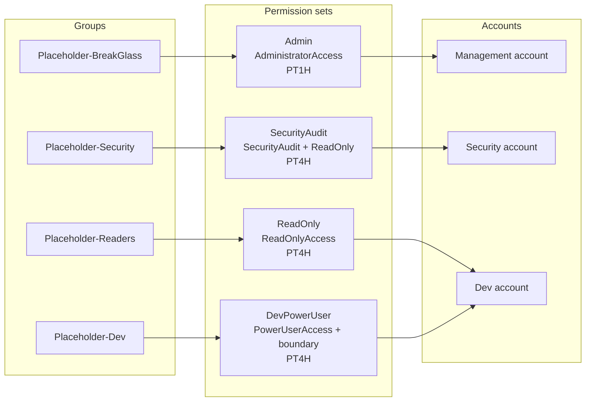

# Identity Center

Root module for IAM Identity Center permission sets, groups, and account assignments. It uses the instance that already exists in the provider region. It does not create the instance, and it does not create users.

State is stored in the bucket from [bootstrap/state-backend](../bootstrap/state-backend), at `identity-center/terraform.tfstate`.



The diagram is the intended shape. Account ids come from `assignments` in tfvars. DevPowerUser is refused in the management account.

Apply it with an SSO session or an assumed-role admin profile in the management account, or in the Identity Center delegated admin account. Do not use the root user. Do not create access keys.

## Apply order

1. Apply [organization](../organization) and attach [scps](../scps) at least to Workloads-Dev.
2. In the Identity Center console, create the instance in one region if it does not exist. This root only reads it. Pick that region as `aws_region` and do not enable a second instance.
3. Set MFA before handing the directory to people. See below. The console owns that setting. Terraform cannot.
4. In each account that will receive DevPowerUser, apply [modules/dev-power-user-boundary](modules/dev-power-user-boundary) with that account's credentials. The permission set only stores the policy name. Identity Center fails the assignment if the named policy is missing in the target account.
5. Apply this root.

```bash
export AWS_PROFILE=your-admin-profile
cd identity-center
cp terraform.tfvars.example terraform.tfvars
cp backend.hcl.example backend.hcl
```

Edit `backend.hcl` from the state-backend outputs. Leave the key as `identity-center/terraform.tfstate`. Edit `terraform.tfvars`. Replace the placeholder account ids. Set `create_groups` to true only when those display names should be created.

```bash
terraform init -backend=false
terraform test
terraform init -backend-config=backend.hcl
terraform plan -out=tfplan
terraform apply tfplan
```

`terraform test` does not need AWS. `terraform.tfvars` and `backend.hcl` are gitignored. Do not paste a plan that contains real account ids into a pull request.

## Permission sets

| Set | Managed policies | Session | Where it belongs |
| --- | --- | --- | --- |
| Admin | AdministratorAccess | PT1H | Management account and break-glass only |
| ReadOnly | ReadOnlyAccess | PT4H | Read configuration and data |
| SecurityAudit | SecurityAudit and ReadOnlyAccess | PT4H | Security account |
| DevPowerUser | PowerUserAccess, plus a customer-managed permissions boundary | PT4H | Workload accounts, never the management account |

ReadOnlyAccess can read object bodies and log events. [ViewOnlyAccess](https://docs.aws.amazon.com/aws-managed-policy/latest/reference/ViewOnlyAccess.html) is the narrower console policy: list, describe, and get, without reading data such as `s3:GetObject`. This set uses ReadOnlyAccess so an investigator can read configuration. Change the managed policy attachment to ViewOnlyAccess if the group must not read data.

`relay_state` is optional. Leave it null to keep the Identity Center default start page.

## Permissions boundary

[`boundary/dev-power-user-boundary.json`](boundary/dev-power-user-boundary.json) is the document. The module creates it; this root does not.

A permissions boundary is a ceiling. The statement `Allow *` is that ceiling. The deny statements are the control:

- IAM users, access keys, and login profiles
- Organization changes, including leaving the organization
- Disabling or deleting CloudTrail, GuardDuty, AWS Config, and IAM Access Analyzer (the same actions as the SCP)
- Editing or deleting this boundary policy
- Swapping or removing a role's boundary
- Creating, changing, or passing a role that does not have this boundary

PowerUserAccess already omits most of IAM and Organizations. The boundary still denies those actions so a later change to the permission set cannot outgrow the cap. `iam:PassRole` is denied unless the role being passed has this boundary. PowerUserAccess does not grant `iam:PassRole` today, so day-to-day developers do not lose a permission they have. A service role that lacks this boundary cannot be passed until the permission set is changed on purpose.

The policy name is `DevPowerUserBoundary` at path `/`. The JSON and `dev_power_user_boundary_name` must stay the same. No account ID is written into the document. The ARN pattern is `arn:aws:iam::*:policy/DevPowerUserBoundary`.

## Groups

`assignments` maps a group display name to a list of permission set and account id. With `create_groups = false`, the groups must already exist and are read by display name. With `create_groups = true`, this root creates them. Add people in the console. This root has no `aws_identitystore_user` resource.

Account ids must be 12 digits. A DevPowerUser assignment whose account id equals `management_account_id` fails the plan.

## MFA

Identity Center MFA is console-only. Set it on the instance before the first human sign-in:

- Prompt for MFA on every sign-in, not only when the sign-in context changes.
- Allow authenticator apps and security keys.
- Do not allow SMS or email one-time passwords.
- Require a person who has no device to register one at sign-in.

Terraform does not manage that screen. The one-hour Admin session and the four-hour working sessions assume MFA already ran at sign-in.

## Tests

```bash
terraform init -backend=false
terraform test
```

The test mocks the provider and the instance data source. It checks session durations, the managed policies, the DevPowerUser boundary attachment, the boundary statement ids, rejection of a short account id, and rejection of DevPowerUser in the management account.
