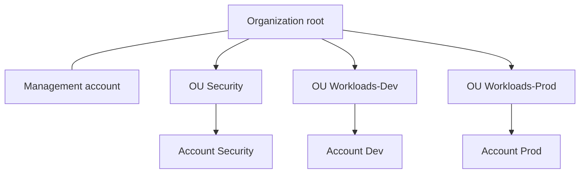

# Organization

Root module for the AWS organization. It creates the organization, three top-level organizational units, and three member accounts. State is stored in the bucket from [bootstrap/state-backend](../bootstrap/state-backend).



The management account is the account you apply from. It already exists, it stays in the organization root, and this module does not create it. Service control policies do not apply to the management account. Each member account sits in one OU.

Apply it with an SSO session or an assumed-role admin profile in the management account. Do not use the root user. Do not create access keys.

## What the first apply does

- Creates the organization with all features, or adopts the organization this management account already owns. It does not create a second organization. If this account is a member of someone else's organization, stop.
- Enables service control policies and tag policies. Tag policies do nothing until a later milestone attaches one.
- Enables trusted access for CloudTrail, GuardDuty, IAM Identity Center, IAM Access Analyzer, and AWS Config. Trusted access is only the organization switch. It does not create a trail, a detector, an analyzer, a configuration recorder, or an Identity Center instance. Those stay in later milestones, and each service should be set up with its own API so it can create the resources it needs.
- Creates the Security, Workloads-Dev, and Workloads-Prod OUs under the root.
- Creates the Security, Dev, and Prod accounts, one after another. Parallel account creation against a new organization fails while the organization is still finalizing. Each account is allowed 60 minutes. A first apply of all three often takes most of an hour.
- Sets `iam_user_access_to_billing` to `DENY`, so member-account IAM users and roles cannot open billing. Billing stays in the management account. The API default is `ALLOW`, which is why the argument is set.
- Asks Organizations to create `OrganizationAccountAccessRole` in each member account. That role trusts the management account and has administrator access in the member. It is the bridge until Identity Center permission sets exist. It is not a day-to-day login. Later service control policies still apply to it.

`role_name` and `iam_user_access_to_billing` are create-only. `DescribeAccount` does not return them, and changing either one would replace the account. Terraform ignores later drift on those two arguments so a refresh cannot plan a replacement. The create call still sends both values.

The account email is also fixed after creation. A change to `account_emails` plans a new account, and `prevent_destroy` rejects that plan. Pick addresses that can receive mail and that no AWS account already uses.

## Apply

The state bucket must already exist. Copy the examples and fill them in locally. `terraform.tfvars` and `backend.hcl` are gitignored.

```bash
export AWS_PROFILE=your-admin-profile
cd organization
cp terraform.tfvars.example terraform.tfvars
cp backend.hcl.example backend.hcl
```

Edit `terraform.tfvars`. Replace the three `example.com` addresses. Edit `backend.hcl` from the state-backend outputs: bucket name, region, and KMS key ARN. Leave the state key as `organization/terraform.tfstate`.

```bash
terraform init -backend-config=backend.hcl
terraform plan -out=tfplan
terraform apply tfplan
```

Review the plan before `apply`. The email addresses are a sensitive variable, so the plan redacts them. Account IDs appear in the outputs after apply. Those IDs are not secret, and they still do not belong in a pull request. `backend.hcl` contains the KMS key ARN, and that ARN contains the account ID. Keep it in a password manager.

`pre-commit` runs `terraform validate` with `-backend=false`, so the hooks do not need the bucket or AWS credentials.

## Accounts are not closed by this module

`close_on_deletion` is false, and `prevent_destroy` is set on the organization, every OU, and every member account. Destroying these resources is a reviewed change to this configuration, and even then Terraform only removes an account from the organization. It does not close the account.

Closing an account is a manual step in the management account, after the account no longer runs a workload. AWS keeps a closed account in a recoverable state for a limited time. This module does not automate that recovery or that closure.

## Destroy

Leave this module in place. The organization is the root of every later milestone. A destroy plan is expected to fail while `prevent_destroy` is set.
