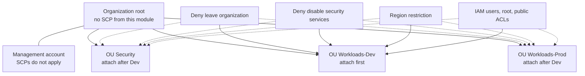

# Service control policies

Root module for the organization guardrails. It creates four deny-only service control policies and attaches them to organizational units you name. State is stored in the bucket from [bootstrap/state-backend](../bootstrap/state-backend). OU ids come from the [organization](../organization) outputs. This module does not read that state itself, so the tests and `terraform validate` run without AWS credentials.



Solid arrows are the first attachment. Dotted arrows are the same four policies, added after a deny has been confirmed in Dev.

Apply it with an SSO session or an assumed-role admin profile in the management account. Do not use the root user. Do not create access keys.

## What is attached

| Policy | Deny | Exempt principals |
| --- | --- | --- |
| `foundation-deny-leave-organization` | `organizations:LeaveOrganization` | none |
| `foundation-deny-disable-security-services` | Disable or delete CloudTrail, GuardDuty, AWS Config, and IAM Access Analyzer | `exempt_principal_arns` |
| `foundation-region-restriction` | Calls whose `aws:RequestedRegion` is outside `allowed_regions` | global service list, and `exempt_principal_arns` |
| `foundation-identity-baseline` | IAM users and passwords, access keys, every action by `arn:aws:iam::*:root`, public S3 ACLs | none |

`organizations:*` is on the region policy's global list, so the region policy does not deny `LeaveOrganization`. The leave-organization policy still denies it. In an SCP, an explicit deny wins.

The region exemption list is IAM, Organizations, STS, Route 53, CloudFront, Support, Budgets, and the other global console APIs in `local.global_service_exemptions`. CloudTrail, GuardDuty, AWS Config, KMS, and bucket-level S3 are not on that list.

`aws:PrincipalArn` is the IAM role ARN, `arn:aws:iam::...:role/Name`. It is not the `arn:aws:sts::...:assumed-role/Name/session` value that `aws sts get-caller-identity` prints. A pattern `arn:aws:iam::*:role/BreakGlass` matches that role name in every member account and does not put an account ID in git. This module does not create the role. Until the role exists, the exemption matches nobody.

Block Public Access is not denied. `DeletePublicAccessBlock` is authorized as `s3:PutBucketPublicAccessBlock`, which is also the action that turns the block on, and an SCP cannot see the four booleans. The identity policy denies public canned ACLs and public grant headers instead.

The documents are `jsonencode` expressions. `terraform test` mocks the AWS provider, and that mock would replace an `aws_iam_policy_document` data source with an empty result. The JSON in the plan is the JSON an apply submits.

The AWS managed `FullAWSAccess` policy stays on the organization root. This module does not detach it. These policies only add denies. Detaching `FullAWSAccess` denies every action that no SCP allows.

## Size

Each document must be at most **5120 characters**. The apply refuses a larger document. `jsonencode` submits compact JSON, and that string is what is counted.

In May 2026 AWS raised the service quota to 10240 characters and to 10 SCPs attached directly to one root, OU, or account. This module keeps the 5120 ceiling so each guardrail stays small enough to review, and so the document still fits an organization that has not picked up the new quota. Four policies attach to each OU in `attach_ou_ids`. Inherited policies, including `FullAWSAccess` on the root, do not consume that OU's attachment count.

## Safe rollout

1. Create the policies with an empty `attach_ou_ids`, or go straight to step 2.
2. Attach only to Workloads-Dev. The example tfvars is this step.
3. In the Dev account, confirm a denied region, an IAM user create, and a CloudTrail stop are denied, and that an allowed region still works.
4. Add the Security and Workloads-Prod ids and apply again.

Rollback is the reverse. Remove an OU id from `attach_ou_ids` and apply. That detaches all four policies from that OU. The policy objects remain.

Do not attach these policies to the organization root. A root attachment would hit every current and future member account in one apply. The variable check rejects a root id (`r-...`) and an account id. The management account is never a target, and SCPs would not filter it anyway.

## Apply

The organization and the state bucket must already exist.

```bash
export AWS_PROFILE=your-admin-profile
cd scps
cp terraform.tfvars.example terraform.tfvars
cp backend.hcl.example backend.hcl
```

Edit `backend.hcl` from the state-backend outputs. Leave the key as `scps/terraform.tfstate`. Edit `terraform.tfvars`. Set `allowed_regions`. Replace `ou-dev0-example1` with the `workloads_dev` id from:

```bash
terraform -chdir=../organization output organizational_unit_ids
```

```bash
terraform init -backend-config=backend.hcl
terraform plan -out=tfplan
terraform apply tfplan
```

`terraform.tfvars` and `backend.hcl` are gitignored. The plan shows the exempt role ARN. Do not paste that plan into a pull request when the ARN contains an account ID.

Security-service changes made with a member-account role are denied unless that role's ARN is in `exempt_principal_arns`. An apply that runs in the management account is not filtered by these SCPs. Milestone 10 can use the management account, or it can add its automation role to the exempt list.

## Tests

From this directory, after `terraform init -backend=false`:

```bash
terraform test
```

The test file mocks the AWS provider and plans. It does not call AWS. It checks the four documents, the Dev-only attachment, rejection of a root id, rejection of an assumed-role session ARN, and the 5120-character ceiling.
